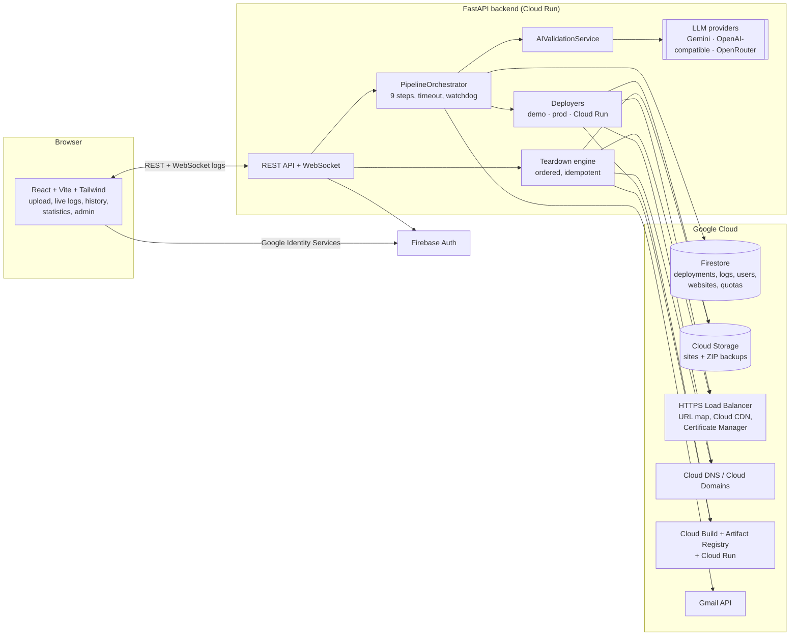
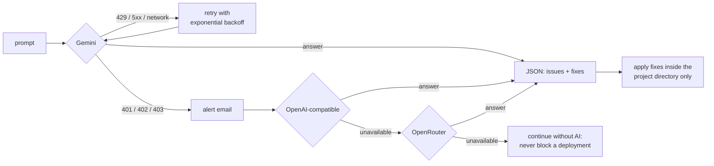
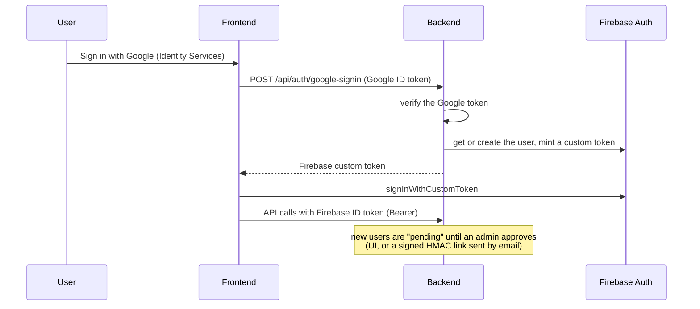

# WebDeploy: AI-assisted website deployment pipeline on Google Cloud

[](https://github.com/choukamani/webdeploy/actions/workflows/ci.yml)


A platform that lets a team deploy a website by uploading a ZIP file:
- **Before building:** an LLM inspects the source and fixes deployment-breaking issues.
- **Deploying:** the pipeline builds and verifies the site, provisions the Google Cloud infrastructure (Cloud Storage, load balancer, CDN, managed certificates, Cloud DNS, or Cloud Run) and uploads the files.
- **Following along:** logs stream live to the browser, and everyone involved is notified by email.

Identifiers of the original deployment (GCP project, domains, people) have been replaced by placeholders such as `your-gcp-project` and `example.com`.

## Problem

Deploying many small websites (marketing pages, demos, client sites) by hand on GCP is slow and error-prone:
- **Infrastructure:** each site needs a bucket, a CDN backend, a routing rule, a certificate and DNS records.
- **Builds:** many Vite projects build fine locally but break under a sub-path (`/my-site/`) because of a missing `base`, absolute asset URLs or a router without `basename`.
- **Cleanup:** removing a site must not leave orphaned resources behind.

WebDeploy turns this into a 9-step, observable, idempotent pipeline behind a web UI, with role-based access and an approval workflow.

## Architecture



### Deployment pipeline (9 steps)

Every deployment runs these steps in order. Each step's status is stored in Firestore and its logs are streamed to the UI over WebSocket. A global timeout (15 minutes by default) and a watchdog protect against stuck runs.

```mermaid
flowchart LR
    A[1 · EXTRACT<br/>unzip, detect Vite /<br/>static / app] --> B[2 · AI_INSPECT<br/>LLM reviews the source]
    B --> C[3 · AI_FIX<br/>apply exact text<br/>replacements]
    C --> D[4 · BUILD<br/>npm ci + vite build<br/>with the right base]
    D --> E[5 · VERIFY<br/>vite preview → HTTP 200,<br/>or Docker image build]
    E --> F[6 · DOMAIN_REGISTER<br/>Cloud Domains,<br/>only if confirmed]
    F --> G[7 · INFRA<br/>bucket, CDN, routing,<br/>certificate, DNS / Cloud Run]
    G --> H[8 · UPLOAD<br/>parallel upload with<br/>Content-Type + Cache-Control]
    H --> I[9 · NOTIFY<br/>HTML email, always,<br/>even after a failure]
```



| Step | Skipped when |
|---|---|
| AI_INSPECT / AI_FIX | AI disabled for the deployment, static HTML site, or no issue found |
| BUILD / VERIFY | Static HTML/CSS/JS project |
| DOMAIN_REGISTER | Not production mode, auto-registration off, or purchase not confirmed |
| NOTIFY | Never: the team is told about failures too |

### Deployment modes

All new sites go through one platform-owned HTTPS load balancer (`webdeploy-sites`). Sites created before it stay on their original load balancer, so a redeploy never changes a URL that was already shared.

| Mode | Public URL | Resources created per site |
|---|---|---|
| **Demo** | `https://demo.example.com/{site}/` | An object prefix in **one shared bucket** behind one CDN backend; no URL-map rule, no backend bucket (avoids URL-map size and backend-bucket quotas) |
| **Production** | `https://{custom-domain}/` | Bucket + CDN backend bucket + host rule + Google-managed certificate (Certificate Manager map) + DNS records (A, `www` CNAME) in an existing or new Cloud DNS zone |
| **Cloud Run** | `https://{site}.example.com/` | Docker image built by Cloud Build (Dockerfile generated if missing) + Cloud Run service + serverless NEG + backend service + host rule + DNS record; wildcard certificate |

External domains (bought at GoDaddy, OVH, Namecheap...) are supported. The pipeline creates a Cloud DNS zone, and the UI shows the nameservers to set at the registrar, with step-by-step instructions. See [`docs/DEPLOYMENT-MODES.md`](docs/DEPLOYMENT-MODES.md) for detailed routing diagrams.

### AI validation with interchangeable providers

The `AI_INSPECT` step sends the relevant source files of a Vite project (configuration, `index.html`, JS/TS/CSS; size-capped, `node_modules` excluded) to an LLM. It asks for a strict JSON answer listing issues and **exact text replacements**. The checks cover:
- the `base` in `vite.config`;
- absolute asset URLs in code, HTML and CSS;
- hard-coded navigation links;
- the router `basename`;
- the build scripts.



- **Providers** ([`services/llm_providers.py`](backend/services/llm_providers.py)) implement one small interface. `AI_PROVIDERS` sets the order; a provider without an API key is skipped. The OpenAI-compatible adapter also covers OpenAI, Mistral, Ollama and vLLM. Only `httpx` is used, with no vendor SDK.
- **Errors** are classified: authentication or credit errors are not retried (an alert email goes to `AI_ALERT_EMAILS`), while rate limits, 5xx and network errors are retried.
- **Model output is untrusted.** A fix is applied only if its target resolves *inside* the project directory (`os.path.commonpath`) and the original text is found verbatim.
- **Cost tracking:** token usage is stored per deployment, with the provider and model, for the statistics dashboard.

### Authentication and roles



| Role | Demo | Production | Cloud Run | User and quota admin |
|---|:---:|:---:|:---:|:---:|
| `simple_user` | yes | – | – | – |
| `super_user` | yes | yes | yes | – |
| `admin` | yes | yes | yes | yes |

### Resilience and lifecycle

- **Backups and recovery:** each uploaded ZIP is first backed up to Cloud Storage. A watchdog (every 2 minutes) and the startup recovery re-queue stuck deployments from that backup, at most twice.
- **Idempotent infrastructure:** every resource is checked before creation, so re-running a partially failed deployment is safe. URL-map patches retry with exponential backoff on concurrent-modification errors.
- **Websites and versions:** a *website* (`demo:{name}`, `prod:{domain}`, `cloudrun:{name}`) owns the GCP resources, and each deployment is a version of it. Resource names come from one module ([`infra/layout.py`](backend/infra/layout.py)) shared by the deployers and the teardown engine.
- **Teardown** ([`infra/teardown.py`](backend/infra/teardown.py)) is an ordered, idempotent plan: routing → certificates → backends → storage → DNS → Cloud Run and images.
  - Resources still used by something else are kept and reported, never deleted.
  - A partial failure leaves the website in `delete_failed`; a retry resumes where it stopped.
  - Bulk deletion processes batches of 10 with one URL-map patch per batch.
- **Reporting:** daily, weekly and monthly email reports, plus on-demand reports from the statistics page, cover deployments per person, AI usage and estimated AI cost.

## Design patterns used

| Pattern | Where | Why |
|---|---|---|
| Pipeline / orchestrator | [`services/pipeline_orchestrator.py`](backend/services/pipeline_orchestrator.py) | One place drives the 9 steps, step bookkeeping, timeouts and notifications. |
| Strategy | Deployers in [`infra/`](backend/infra/) (`demo_deployer`, `prod_deployer`, `cloudrun_deployer`, `sites_lb`) | The INFRA step selects the placement strategy from the mode; each one owns its resources. |
| Adapter | [`OpenAICompatibleProvider`, `GeminiProvider`](backend/services/llm_providers.py) | Heterogeneous LLM APIs behind one `complete(prompt)` interface. |
| Chain with fallback | [`AIValidationService._call_providers`](backend/services/ai_validator.py) | Providers are tried in order with per-provider retries; the pipeline degrades gracefully. |
| Template / generator | [`services/dockerfile_generator.py`](backend/services/dockerfile_generator.py) | Picks a Dockerfile template per detected project type (Vite static, Node app, Python FastAPI/Flask, plain HTML). |
| Single source of naming | [`infra/layout.py`](backend/infra/layout.py) | Deployers and teardown compute identical resource names, so nothing is orphaned. |
| Command plan (teardown) | [`infra/teardown.py`](backend/infra/teardown.py) | Deletion is a list of ordered, idempotent, resumable steps. |
| Observer (live logs) | [`api/routes/websocket.py`](backend/api/routes/websocket.py) | Pipeline log events are broadcast to every connected client of a deployment. |

## Tech stack

| Layer | Technologies |
|---|---|
| Backend | Python, FastAPI, Uvicorn, Pydantic / pydantic-settings, WebSockets, httpx, Jinja2 (emails) |
| AI | Gemini API, any OpenAI-compatible API, OpenRouter (provider-agnostic) |
| Data | Firestore (deployments, logs, users, websites, quotas, report locks) |
| Google Cloud | Cloud Storage, HTTPS Load Balancing, Cloud CDN, Certificate Manager, Cloud DNS, Cloud Domains, Cloud Build, Artifact Registry, Cloud Run, Firebase Auth, Gmail API |
| Frontend | React 18, Vite 6, Tailwind CSS 4, React Router 6, Axios, Recharts, Lucide icons |
| Delivery | Docker (dev and prod images), Cloud Build configs, Nginx, GitHub Actions (backend tests, frontend build) |

## Getting started

### Local (with a GCP project)

```bash
cd backend
cp .env.example .env            # fill PROJECT_ID, credentials, domains, AI provider keys
pip install -r requirements.txt
uvicorn main:app --reload --port 8500

cd ../frontend
npm install
npm run dev                     # http://localhost:3500 (proxies /api and /ws to :8500)
```

The backend connects to Firestore at startup, so it needs Application Default Credentials (`gcloud auth application-default login`) or a service-account key in `GOOGLE_APPLICATION_CREDENTIALS`. Docker Compose is also available: `docker-compose up --build`.

### Tests

```bash
cd backend && pip install -r requirements.txt pytest && python -m pytest -q
cd frontend && npm ci && npm run build
```

The 53 backend tests cover the AI providers with mocked HTTP and the fallback, retries and path-safety of the AI validation. They also cover DNS operations, resource layout and teardown, and regressions from code reviews. They need no cloud access.

### Google Cloud setup

Enable the APIs: `compute`, `storage`, `cloudbuild`, `run`, `dns`, `domains`, `firestore`, `artifactregistry`, `certificatemanager`.

The runtime service account needs: `storage.admin`, `compute.admin`, `dns.admin`, `domains.admin`, `run.admin`, `cloudbuild.builds.editor`, `artifactregistry.writer`, `iam.serviceAccountUser`, `iam.serviceAccountTokenCreator` (Firebase custom tokens), `firebaseauth.admin`, `datastore.user` and `certificatemanager.owner`.

Then provision the platform load balancer once (`python -m scripts.provision_sites_lb`, idempotent) and deploy with the Cloud Build configs:

```bash
gcloud builds submit --config=cloudbuild-backend.yaml .
gcloud builds submit --config=cloudbuild-frontend.yaml \
  --substitutions=_VITE_FIREBASE_API_KEY=...,_VITE_FIREBASE_AUTH_DOMAIN=...,_VITE_GOOGLE_CLIENT_ID=...
```

`deploy-staging.sh` deploys a staging copy of both services; it reads `PROJECT_ID`, `APPROVAL_TOKEN_SECRET`, `GOOGLE_CLIENT_ID` and the AI keys from the environment.

### Main configuration

All settings are environment variables (see [`backend/.env.example`](backend/.env.example) and [`backend/config.py`](backend/config.py)):

| Group | Variables |
|---|---|
| GCP | `PROJECT_ID`, `GOOGLE_APPLICATION_CREDENTIALS`, `CLOUDRUN_REGION` |
| Routing | `SITES_LB_PREFIX`, `SITES_DEMO_HOST`, `SITES_APPS_DOMAIN`, `SITES_DNS_ZONE`, legacy `DEMO_*` / `PROD_*` names |
| AI | `AI_PROVIDERS`, `GEMINI_API_KEY`, `GEMINI_MODEL`, `OPENAI_COMPATIBLE_BASE_URL` / `_API_KEY` / `_MODEL`, `OPENROUTER_API_KEY`, `AI_ALERT_EMAILS` |
| Email | `GMAIL_DELEGATED_USER`, `NOTIFICATION_FROM_EMAIL`, `NOTIFICATION_TO_EMAILS`, `DAILY_REPORT_EMAILS` |
| Auth | `ADMIN_APPROVAL_EMAIL`, `APPROVAL_TOKEN_SECRET`, `GOOGLE_CLIENT_ID`, `FRONTEND_URL` |
| Limits | `MAX_ZIP_SIZE_MB`, `BUILD_TIMEOUT_SECONDS`, `PIPELINE_MAX_TIMEOUT_SECONDS` |

## Project structure

```
backend/
├── main.py                 # FastAPI app, lifespan (recovery), watchdog, schedulers
├── config.py               # all settings (pydantic-settings)
├── api/routes/             # deployments, websites, domains, auth, quotas, statistics, git, websocket...
├── services/               # pipeline orchestrator, AI validation + LLM providers, build, upload,
│                           # Cloud Build, Dockerfile generator, domains, email, reports, backups
├── infra/                  # deployers (demo / prod / Cloud Run / sites LB), layout, teardown, DNS, URL map
├── db/                     # Firestore access and statistics queries
├── models/                 # Pydantic / data models and enums
├── scripts/                # one-off provisioning (sites load balancer)
└── tests/                  # pytest suite (no cloud access needed)
frontend/src/               # React pages (deploy, history, detail, statistics, admin), hooks, API client
docs/DEPLOYMENT-MODES.md    # routing diagrams for every mode
```

## Known limitations

- The backend needs a real GCP project to start (Firestore at startup); there is no fully offline mode.
- The AI checks are written for Vite projects (base path, assets, router); static HTML sites skip the step.
- AI fixes are exact text replacements: they cannot restructure code, and a fix whose original text is not found is skipped.
- Production certificates and DNS depend on propagation at the registrar (minutes to 48 hours).

---

## Résumé en français

**WebDeploy** est une plateforme qui permet à une équipe de déployer un site web sur Google Cloud en déposant simplement un fichier ZIP.

**Le pipeline en 9 étapes**, avec logs en temps réel par WebSocket :
1. extraction du ZIP et détection du type de projet ;
2. inspection du code par un LLM ;
3. corrections automatiques sûres ;
4. build ;
5. vérification ;
6. achat de domaine éventuel ;
7. provisionnement de l'infrastructure : bucket, CDN, load balancer, certificats, DNS, ou Cloud Run ;
8. upload des fichiers ;
9. notification par email.

**La validation IA est indépendante du fournisseur.** Gemini, n'importe quelle API compatible OpenAI ou OpenRouter sont essayés dans l'ordre configuré, avec reprises sur erreur. Les corrections proposées par le modèle ne peuvent jamais sortir du dossier du projet.

**Autres fonctions :**
- authentification Google et Firebase avec rôles et workflow d'approbation ;
- suppression ordonnée et idempotente des ressources ;
- reprise automatique des déploiements bloqués ;
- statistiques, rapports périodiques et suivi du coût de l'IA ;
- 53 tests backend exécutables sans accès au cloud.
